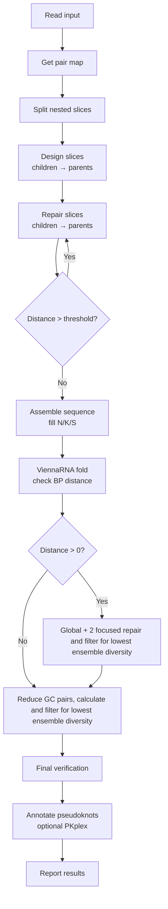
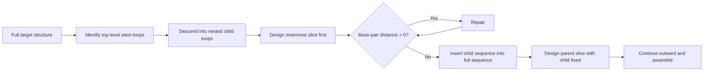
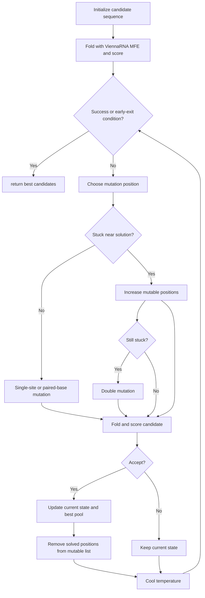

# AROS - Automated RNA Optimization by Slicing

**Team Aarhus University 2026 – Software**
## Table of contents

- [Quick start: macOS](#quick-start-macos)
- [Quick start: Linux](#quick-start-linux)
- [Quick start: Windows (MSYS2)](#quick-start-windows-msys2)
- [Troubleshooting](#troubleshooting)
- [Overview](#overview)
- [How it works](#how-it-works)
  - [1. Slicing the target](#1-slicing-the-target)
  - [2. Designing a slice](#2-designing-a-slice)
  - [3. Repairing the full sequence](#3-repairing-the-full-sequence)
  - [4. Pseudoknot verification and annotation](#4-pseudoknot-verification-and-annotation)
  - [Supported platforms](#supported-platforms)
- [Installation](#installation)
  - [Requirements](#requirements)
  - [Git LFS (required)](#git-lfs-required)
- [Usage](#usage)
  - [Input and output files](#input-and-output-files)
- [Example](#example)
- [Data and large files](#data-and-large-files)
- [Contributing](#contributing)
  - [Native dependencies](#native-dependencies)
  - [Continuous integration](#continuous-integration)
  - [Project structure](#project-structure)
- [Authors and acknowledgment](#authors-and-acknowledgment)
- [License](#license)
- [Citation](#citation)

### Quick start: macOS

Clone the repository and run the setup script:

```bash
git clone https://gitlab.igem.org/2026/software/aarhus-university/ribologic-rna-sequence-generator.git
cd ribologic-rna-sequence-generator

# Run setup in the current shell so Cargo and native-library environment
# variables remain available immediately afterward.
source ./setup.sh
```
The setup script installs required tools when needed and builds the project. This works the same way on Intel and Apple Silicon Macs, because `setup.sh` detects your CPU architecture and targets it automatically.

Then run the program (`--release` is faster):

```bash
cargo run --release
```

If Rust was not installed automatically, install it with:

```bash
curl --proto '=https' --tlsv1.2 -sSf https://sh.rustup.rs | sh
source "$HOME/.cargo/env"
```

### Quick start: Linux

Install the system requirements shown above, then clone the repository:

```bash
git clone https://gitlab.igem.org/2026/software/aarhus-university/ribologic-rna-sequence-generator.git
cd ribologic-rna-sequence-generator
# `source` keeps PATH and other setup environment variables in this shell.
source ./setup.sh

cargo run --release
```

This works on both `x86_64` and `arm64` Linux; `setup.sh` detects your architecture and builds ViennaRNA from source if a prebuilt archive isn't already vendored.

### Quick start: Windows (MSYS2)

Native Windows is supported on `x86_64` (MinGW64) and `ARM64` (CLANGARM64).

1. Install [MSYS2](https://www.msys2.org/).
2. Open the MSYS2 terminal that matches your CPU from the Start menu (this specific shell is required):

   | Your Windows | Open this terminal |
   |---|---|
   | x86_64 (Intel/AMD) | **MSYS2 MinGW x64** |
   | ARM64 | **MSYS2 CLANGARM64** |

    > This specific terminal is required. Do not use PowerShell, Command Prompt,
    > Git Bash, WSL, the plain MSYS2 shell, UCRT64, CLANG64, or MinGW x86 (`MINGW32`).
3. Install Git and Git LFS if they are not already available. The package prefix adapts to the terminal you opened:

   ```bash
   pacman -S --needed git "$MINGW_PACKAGE_PREFIX-git-lfs"
   git lfs install
   ```
4. Clone the repository and run the setup script:
   ```bash
   git clone https://gitlab.igem.org/2026/software/aarhus-university/ribologic-rna-sequence-generator.git
   cd ribologic-rna-sequence-generator
   source ./setup.sh
   ```
   `setup.sh` detects which terminal you are in. It installs the matching toolchain, GMP, MPFR, and GSL via `pacman`, builds ViennaRNA from source, and adds the right Rust target (`x86_64-pc-windows-gnu` or `aarch64-pc-windows-gnullvm`). The first run can take a long time, especially on ARM64.
5. Run the program, targeting the GNU toolchain for your platform:

   ```bash
   # x86_64 (MSYS2 MinGW x64)
   cargo run --release --target x86_64-pc-windows-gnu

   # ARM64 (MSYS2 CLANGARM64)
   cargo run --release --target aarch64-pc-windows-gnullvm
   ```

> Windows x86 (32-bit) is not supported: MSYS2's `MINGW32` repository no longer provides `clang` or GSL.

## Troubleshooting

| Problem | Fix |
|---|---|
| Build fails with tiny "pointer" files in `vendor/` or linker errors about `libRNA.a` | Git LFS did not download the vendored files. Run `git lfs install && git lfs pull` from the repository root. |
| `setup.sh` fails on Windows, or says `Unsupported MSYS2 environment` | Open **MSYS2 MinGW x64** (x86_64) or **MSYS2 CLANGARM64** (ARM64) specifically. PowerShell, CMD, Git Bash, WSL, plain MSYS2, UCRT64, CLANG64, and MinGW x86 are unsupported for the native Windows build. |
| `cargo: command not found` immediately after setup | Run `source ./setup.sh`, not `./setup.sh`. Alternatively, close and reopen the terminal after Rust installation. |
| `cargo: command not found` on Windows after reopening MSYS2 | Confirm that Rust is installed, then run `source ./setup.sh` from MSYS2 MinGW x64 or CLANGARM64. |
| `bindgen` cannot find `libclang` | Run `source ./setup.sh` again. On Linux, ensure `clang` and `libclang-dev` are installed. |
| Setup appears frozen during Windows installation | The first run may download/install a large toolchain and build ViennaRNA (the ARM64 build can take 30+ minutes). Let `pacman` and `make` finish. |
| `pacman` reports `failed retrieving file` or `Operation too slow` | A package mirror stalled. `setup.sh` retries automatically; if it still fails, run `source ./setup.sh` again. |
| Linker errors such as `undefined symbol: omp_set_dynamic` or `pthread_mutex_lock` on Windows | The vendored libraries were built with an older setup. Delete `vendor/RNAlib/prebuilt/<your-target>/` and run `source ./setup.sh` again to rebuild them. |
| Setup seems frozen on an Intel Mac | Homebrew may be compiling dependencies such as LLVM from source. This can take a long time. |
| Program uses all CPU cores | Lower the number of parallel runs at the second prompt. |


# Overview

A Rust-based RNA sequence design tool built on the
[ViennaRNA](https://www.tbi.univie.ac.at/RNA/) library. Given a target
RNA secondary structure in dot-bracket notation, it searches for
sequences that fold into that structure. It uses ViennaRNA's
minimum-free-energy (MFE) folding to score candidates, runs several
rounds of a parallel multi-start hill-climbing design procedure, and
reports the best results.

Team wiki: https://2026.igem.wiki/aarhus-university/

The program supports two sequence-generation modes:

1.  **Generate from ambiguous nucleotides** Generate sequences from an
    input sequence containing ambiguous RNA nucleotide symbols such as:

    -   `N` --- any nucleotide
    -   `K` --- `G` or `U`
    -   `S` --- `G` or `C`

2.  **Generate from a preferred starting sequence** When
    `const RIBOSOMAL_RNA : bool = true;` is enabled in the program
    configuration, generation begins from the ribosomal large-subunit
    rRNA sequence, or any other query sequence of your choice.

    The output includes a percentage score indicating how much of the
    original sequence remains in the generated sequence. Note that with
    this method the program uses longer time to converge towards target
    structure, or might not quite reach it at all (`bp_distance > 0`)

Other features:

-   Configurable number of design rounds and parallel runs.
-   Optional scrollable in-terminal viewer for the results, so you don't
    have to open multiple output files to find a candidate.
-   Cross-platform: macOS (Intel and Apple Silicon), Linux, and Windows.

> **Note:** The `Python/` folder and Python script are legacy files and
> are not used by the current program.

## How it works

AROS designs sequences in four stages. It splits the target into
nested **slices**, designs each slice with a hill-climbing search,
repairs the assembled sequence globally, and finally verifies and
annotates pseudoknots.




### 1. Slicing the target

ViennaRNA's MFE algorithm (Zuker) runs in O(n³), so folding one long
sequence over and over is slow. Instead the target is broken into
smaller problems, **slices**, which are solved in parallel:



The `slices` value in the output is the number of slices the target was
split into.

### 2. Designing a slice

Each slice is passed to `multi_start_hill_climb_design()`, which runs
several independent `hill_climb_design()` searches in parallel (5 by
default). Each search works like this:





For slices, the search exits early when the base-pair distance falls
below a threshold that depends on the number of designable positions
and the partition function shows that the remaining
nucleotides are only weakly paired (always below 0.7).

#### Scoring a candidate
 
1.  **Strip pseudoknots.** ViennaRNA does not fold pseudoknots directly,
    so `[` and `]` in the target are converted to dots.
2.  **Mask fixed bases.** Fixed bases at positions that are unpaired in
    the target are left untouched.
3.  **Fold.** ViennaRNA computes the MFE structure.
4.  **Measure the distance** to the pseudoknot-stripped target with
    `vrna_bp_distance()`:
``` math
D_{\text{VRNA}} = \text{BPDistance}(S_{\text{MFE}},\, S_{\text{target without PK}})
```
 
Pseudoknot pairs are stored in a pair map, mutated together with the
sequence, and scored with a penalty for each invalid pair and
wobble-baspair:
 
``` math
D_{\text{candidate}} = D_{\text{VRNA}} + 2 \times N_{\text{invalid PK pairs}}
```
 
A score of `0` means the candidate folds exactly into the target.
 
#### Energy gap
 
Two candidates can tie on $D_{\text{candidate}}$ while differing in how
*thermodynamically favorable* the target fold actually is for each of
them — one sequence might only be reachable within that base-pair
distance, while another actually folds into it as its true minimum-free-
energy structure. `energy_of_target_structure` measures this directly:
 
``` math
\Delta E = \max\!\Big(0,\; E(S_{\text{target}} \mid \text{seq}) - E_{\text{MFE}}(\text{seq})\Big)
```
 
- $E(S_{\text{target}} \mid \text{seq})$ is the free energy of folding the candidate sequence specifically into the *target* structure (via `vrna_eval_structure`), whether or not that's the sequence's actual MFE fold.
- $E_{\text{MFE}}(\text{seq})$ is the free energy of the sequence's true MFE structure, from `vrna_mfe`.
- The gap is clamped at `0`, since the target structure can never be more stable than the true MFE structure.
A gap of `0` means the target structure *is* the sequence's MFE fold — the strongest possible outcome. A larger gap means the target is only a local, less-favored fold, making it more likely the sequence "escapes" to a different structure in practice. `current_energy_gap` is recomputed every time a candidate is accepted, so it always reflects the live current state rather than a stale prior candidate.
 
#### Accepting candidates
 
A candidate replaces the current one if its distance is lower, or if the
distance is equal and its **energy gap** $\Delta E$ is smaller (same
structure, more thermodynamically stable). Even on a tied distance with
a larger gap, the candidate can still be accepted probabilistically:
 
``` math
P(\text{accept tied, worse gap}) = \exp\!\left(-\frac{\Delta E_{\text{candidate}} - \Delta E_{\text{current}}}{T}\right)
```
 
A worse candidate is still accepted with probability
 
``` math
P(\text{accept worse}) = \exp\!\left(-\frac{D_{\text{candidate}} - D_{\text{current}}}{T}\right)
```
 
where the temperature $T$ decreases linearly over time, so the search
shifts from exploring to refining. If progress stalls once $T$ reaches
its minimum of `0.05`, it is reset to `1`. The cooling rate is set from
the number of designable positions.


### 3. Repairing the full sequence

**Global repair.** The best slice designs are assembled into the full
sequence and the base-pair distance is recomputed. The remaining
mismatched positions are then repaired in parallel for at most 800
iterations, where the iteration count scales with the distance:

``` math
\text{repair steps} = \min\left(800,\; \frac{d_{\text{bp}}}{0.008}\right)
```

where $d_{\text{bp}}$ is the base-pair distance of the assembled
sequence.

It stops when the iteration limit is reached, or when the distance is
below a precomputed threshold and the partition function shows low pair
probabilities (about 0.5). A repaired sequence replaces the original
only if it improves on it.

**The final focused repairs.** If the distance is still not below 2--3,
`multi_start_hill_climb_design()` runs twice more on the remaining
mismatches. This time all paired nucleotides start as G--C pairs to
favour strong stems. The exit criteria are stricter on pair
probabilities (0.1) and looser on distance (3--5), and the iteration
count is clamped between 1 and 100.

**GC-cleanup**. After the the final repairs all GC-pairs in the
designable positions are attempted substidized for AU-pairs while
keeping the base-pair distance unchanged, or reduced. This is to reduce
the inflated GC-content which usually ends up at around 80% before this
step.

### 4. Pseudoknot verification and annotation

The ViennaRNA MFE structure contains no pseudoknots, so they are
reinstated at the target's pseudoknot positions wherever the designed
bases can form valid pairs. This should always be the case, since
pseudoknot positions are treated as paired during design. The program
then runs ViennaRNA's PKplex as a final, separate pseudoknot check.

The reported **MFE structure with PK** is therefore the ViennaRNA MFE
structure for the ordinary nested pairs, plus the target's pseudoknot
brackets where the sequence supports valid base pairs. It is **not** a
full thermodynamic pseudoknot MFE prediction. PKplex output is the
separate pseudoknot-oriented check.


### Supported platforms

`setup.sh` detects your OS/CPU and stages the correct prebuilt (or freshly built) native libraries automatically.

| Platform | Architecture | MSYS2 environment | Status |
|---|---|---|---|
| macOS | Intel (`x86_64-apple-darwin`) | – | Tested manually (not currently in CI) |
| macOS | Apple Silicon (`aarch64-apple-darwin`) | – | Tested in GitHub Actions CI |
| Linux | `x86_64-unknown-linux-gnu` (Ubuntu 22.04 and 24.04) | – | Tested in GitHub Actions CI |
| Linux | `aarch64-unknown-linux-gnu` (Ubuntu 22.04 and 24.04) | – | Tested in GitHub Actions CI (ARM64 runners) |
| Windows | `x86_64-pc-windows-gnu` | MinGW64 | Tested in GitHub Actions CI |
| Windows | `aarch64-pc-windows-gnullvm` | CLANGARM64 | Tested in GitHub Actions CI (ARM64 runner) |
| WSL2 | Treated as Linux | – | Supported by `setup.sh` |

> **Windows x86 (32-bit) is not supported.** MSYS2's 32-bit `MINGW32` repository no longer provides `clang` (needed by Rust `bindgen`) or GSL, so the native libraries cannot be built there.

On macOS and Linux, ViennaRNA is built from source by `setup.sh` if a prebuilt archive is not already present in `vendor/`; GSL, MPFR, and GMP are pulled from your package manager (Homebrew or your Linux distribution's package manager). On Windows, all native libraries (including ViennaRNA) are built from source using MSYS2: GCC in the MinGW64 environment for x86_64, and Clang in the CLANGARM64 environment for ARM64.

## Installation

### Requirements

#### All platforms

- Git and **Git LFS** (see [Git LFS](#git-lfs-required) below)
- At least 2–3 GB of free disk space for Rust, compiler toolchains, downloaded packages, and native-library builds
- An Internet connection for the first setup run


#### macOS

- Intel or Apple Silicon Mac
- Xcode Command Line Tools (`xcode-select --install`)
- Homebrew (installed automatically by `setup.sh` if missing)

> **Intel Macs:** Homebrew no longer provides prebuilt bottles for Intel, so `brew install` may compile dependencies (for example LLVM) from source, which can take a very long time. If a build seems idle, it is usually still compiling.

#### Linux

- `x86_64` or `arm64` Linux
- Rust toolchain
- Clang and `libclang` development files, required by Rust `bindgen`
- A supported package manager: `apt`, `dnf`, `yum`, `pacman`, or `zypper`

For Ubuntu or Debian-based distributions:

```bash
sudo apt-get update
sudo apt-get install -y \
  build-essential \
  clang \
  libclang-dev \
  pkg-config \
  git \
  git-lfs \
  curl
```

#### Windows

- Windows 10 or Windows 11 on `x86_64` or `ARM64`
- [MSYS2](https://www.msys2.org/) installed
- The build must be run from the matching MSYS2 terminal:
  - **MSYS2 MinGW x64** on `x86_64` Windows
  - **MSYS2 CLANGARM64** on `ARM64` Windows

  Do **not** use PowerShell, Command Prompt, Git Bash, WSL, the plain MSYS2 shell, UCRT64, CLANG64, or MinGW x86 (`MINGW32`).
- Internet access for the initial `pacman`, Rust, and ViennaRNA setup

`setup.sh` reads the active MSYS2 environment and selects the matching Rust toolchain and target automatically:

| MSYS2 terminal | Rust toolchain | Rust target |
|---|---|---|
| MinGW x64 | `stable-x86_64-pc-windows-gnu` | `x86_64-pc-windows-gnu` |
| CLANGARM64 | `stable-aarch64-pc-windows-gnullvm` | `aarch64-pc-windows-gnullvm` |

It also installs the required MSYS2 packages for that environment. The first Windows setup may take a long time (the ARM64 build in particular) because it downloads compilers, LLVM/Clang, autotools, GMP, MPFR, GSL, and builds ViennaRNA.


### Git LFS (required)

The prebuilt native libraries in `vendor/` are large binaries and are stored with [Git LFS](https://git-lfs.com). Install Git LFS **before cloning**, otherwise you will get small pointer files instead of the real libraries and the build will fail.

```bash
# macOS (Apple Silicon)
brew install git-lfs

# Ubuntu / Debian
sudo apt-get install git-lfs

# Windows (MSYS2 MinGW x64 or CLANGARM64)
pacman -S --needed git-lfs

# Once per machine:
git lfs install
```

If you already cloned without Git LFS, run this inside the repository:

```bash
git lfs pull
```


## Usage

Run this command from the repository root, the directory containing `Cargo.toml`:

```bash
cargo run
```

For an optimized release build:

```bash
cargo run --release
```

On Windows, also pass `--target` for your platform to both commands: `--target x86_64-pc-windows-gnu` on x86_64, or `--target aarch64-pc-windows-gnullvm` on ARM64.

When the program starts you will be asked:

1. **How many rounds to run.** Type a number and press Enter. The default is three rounds.
2. **How many runs `multi_start_hill_climb_design()` should execute in parallel.** The default is five. The more parallel runs you choose, the more CPU cores are used, so choose with consideration.

Once the run has finished you can choose to view the results as a scrollable element in the terminal (y/n). This is useful for comparing candidates without opening multiple output files.

### Input and output files

Input files are located in:

```
misc/
```

They are named with the `input_` prefix. Each input file must contain:

- An RNA sequence
- A matching RNA secondary structure in dot-bracket notation

For example:

```
Sequence:  GGGAAACCC
Structure: (((...)))
```

The sequence and structure must have the same length.

Generated output files are written to:

```
misc/output/
```

## Example

**Input**: a file in `misc/` with the `input_` prefix, for example `misc/input_1.txt`:

```
Sequence: NNNKNNNNKNNNNNKNNNNKNNUUCGNNKNNNNKNNNNNNKNNNNKNNUUCGNNKNNNNKNNNNNNKNNNAANNNNNNANNNKNNNNNKNNNNKNNNNNNNNNKNNNNNNNNKNNAANNNNNNANNKNNNNNNNKNNNNKNNUUCGNNKNNNNKNNNNKNNNNNKNNNUUCGNNNKNNNNNKNNNNNKNNNNNN
Structure: ((((((((((((((((((((((....)))))))))))(((((((((((....)))))))))))(((((((..[[[[[[.))))))))))))))))))((((((((((((((((((..]]]]]].)))))))(((((((((((....)))))))))))(((((((((((....))))))))))))))))))))))
```

The sequence and structure must be the same length.

**Run**:

```
$ cargo run
    Finished `dev` profile [unoptimized + debuginfo] target(s) in 0.23s
     Running `target/debug/Ribosome_mut_program`
========================================
RNA design configuration
Press Enter to accept a default value.
========================================
How many complete runs should be performed? [3]: 10
How many hill-climbing starts per run? [5]: 8
```

**Output**: written to `misc/output/`, and viewable in the terminal when asked (y/n):

run 4 was the best of the 10:
```
INPUT: misc/input_1.txt
==== FINAL (run 1) ====
sequence     : UCGUAAAUUGGGGUGGAUUUCGUUCGCGGAAUCUACCGACUGAUAGAGUUCGCUUUAUCGGUCGCUGCAUAAGUAUAGAAUGUAGCCCGAUUUGCGACUGAUCUCAACCCACUACAACUAUACAGUGGUGGCCUUAAAUGGCUUCGGCUAUUUGAGGGGGGCGGUACCUUCGGGUGCCGCCUCGUUGGGAUCAG
target       : ((((((((((((((((((((((....)))))))))))(((((((((((....)))))))))))(((((((..[[[[[[.))))))))))))))))))((((((((((((((((((..]]]]]].)))))))(((((((((((....)))))))))))(((((((((((....))))))))))))))))))))))
mfe structure: ((((((((((((((((((((((....)))))))))))(((((((((((....)))))))))))(((((((..[[[[[[.))))))))))))))))))((((((((((((((((((..]]]]]].)))))))(((((((((((....)))))))))))(((((((((((....))))))))))))))))))))))
bp_distance  : 0
mfe          : -101.80
Ensemble Diversity: 0.74
slices       : 8
Ribosomal RNA used: false
GC Content: 51.03%
```

**Reading the result**

| Field | Meaning |
|---|---|
| `sequence` | The generated RNA sequence |
| `target` | The structure you asked for (dot-bracket) |
| `mfe structure` | The structure ViennaRNA predicts for the sequence |
| `bp_distance` | Base-pair distance between target and predicted structure. `0` means an exact match |
| `mfe` | Minimum free energy of the predicted structure in kcal/mol. More negative means more stable |
| `Ensemble Diversity` | The average distance between the structures in an ensemble. It essentially means how many different structures can be predicted from the same sequence |
| `slices` | Number of substructures the target was split into during design |
| `Ribosomal RNA used` | Which mode was run. If `true`, a sequence-identity percentage is also shown |
| `GC Content` | Fraction of G and C. High GC generally stabilises stems and hairpins |

**Using a starting sequence**: to begin from a query sequence instead of ambiguous nucleotides, set `const RIBOSOMAL_RNA: bool = true;` in `src/main.rs` and put your query sequence in `const RIBOSOME_SEQUENCE: &str = "...";`. Then rebuild and run with `cargo run --release` (or `cargo run` for a debug build, which is slower).


## Data and large files

Keep this repository for **source code**. For datasets, machine-learning model weights, large media, and other heavy artifacts, use [Zenodo](https://teams.igem.org/go/deliverables/software/zenodo) — it gives each upload a citable DOI and is the recommended long-term archive for iGEM teams. Reference your Zenodo records from this README so judges and future teams can find them.

The one exception in this repository is the prebuilt native libraries in `vendor/RNAlib/prebuilt/`, which are stored with Git LFS (see [Git LFS](#git-lfs-required)) so the project builds out of the box. Generated results in `misc/output/` should not be committed.

## Contributing

We welcome contributions. To get started:

1. Install the requirements for your platform and Git LFS (see [Installation](#installation)).
2. Clone the repository and run `source ./setup.sh` from a supported shell (see the quick starts above).
3. Create a branch, make your changes, and open a merge request against `main`.

> **Using an AI assistant (e.g. Claude Code)?** Please read [.claude/RESPONSIBLE_AI_USE.md](.claude/RESPONSIBLE_AI_USE.md) first. You remain fully responsible for everything you commit: don't misrepresent what your tool does, never commit secrets, and review every change.

Useful commands:

```bash
cargo build            # debug build
cargo run --release    # optimized build and run
```

For Windows, add the target for your platform:

```bash
# x86_64 (MSYS2 MinGW x64)
cargo build --target x86_64-pc-windows-gnu
cargo run --release --target x86_64-pc-windows-gnu

# ARM64 (MSYS2 CLANGARM64)
cargo build --target aarch64-pc-windows-gnullvm
cargo run --release --target aarch64-pc-windows-gnullvm
```

> **C types and portability:** when calling ViennaRNA, use `std::os::raw::c_char` rather than `i8`/`u8`. `c_char` is unsigned on some platforms (Linux ARM64) and signed on others, so hardcoding either breaks a build somewhere.

### Native dependencies

The project uses the following native libraries:

- **ViennaRNA** — RNA secondary-structure prediction and MFE folding
- **GMP** — GNU Multiple Precision Arithmetic Library
- **MPFR** — multiple-precision floating-point arithmetic
- **GSL** — GNU Scientific Library

On macOS, Linux, and Windows, `setup.sh` builds and/or copies these into a target-specific directory under `vendor/RNAlib/prebuilt/`, for example:

```
vendor/RNAlib/prebuilt/x86_64-unknown-linux-gnu/
vendor/RNAlib/prebuilt/aarch64-apple-darwin/
vendor/RNAlib/prebuilt/x86_64-pc-windows-gnu/
vendor/RNAlib/prebuilt/aarch64-pc-windows-gnullvm/
```

The Rust build script (`build.rs`) selects the correct prebuilt library directory for the current target platform and expects the ViennaRNA headers in `vendor/RNAlib/include/ViennaRNA`.

Platform notes for `build.rs`:

- **Windows ARM64 (`gnullvm`):** libraries are built with Clang, so the build links LLVM's C++ runtime (`c++`) and `winpthread` instead of `stdc++` and `gomp`. Because Clang does not recognise Rust's `gnullvm` triple, bindgen is passed the equivalent `gnu` triple.
- **Windows x86_64 (MinGW64):** links `stdc++` and `gomp`.
- **ViennaRNA is built without OpenMP** on Windows (`--disable-openmp`).

### Continuous integration

The GitHub mirror runs `.github/workflows/test-all-platforms.yml`, which tests:

- macOS Apple Silicon: `aarch64-apple-darwin`
- Linux x86_64: `x86_64-unknown-linux-gnu` on Ubuntu 22.04 and 24.04
- Linux ARM64: `aarch64-unknown-linux-gnu` on Ubuntu 22.04 and 24.04 (GitHub-hosted ARM64 runners)
- Windows x86_64, MSYS2 MinGW64: `x86_64-pc-windows-gnu`
- Windows ARM64, MSYS2 CLANGARM64: `aarch64-pc-windows-gnullvm`

macOS Intel (`x86_64-apple-darwin`) is currently disabled in the workflow. Windows x86 (`i686-pc-windows-gnu`) is not tested because it is not supported (see [Supported platforms](#supported-platforms)).

The Windows CI jobs select the MSYS2 environment from the build matrix (`MINGW64` or `CLANGARM64`), run `source ./setup.sh`, build ViennaRNA and the native dependencies, and run both `cargo test` and `cargo build` for the matching GNU target.

These GitHub Actions workflows run on the GitHub mirror; they do not run automatically in the GitLab repository.

### Project structure

```
AROS-rna-sequence-generator/
├── Cargo.toml
├── Cargo.lock
├── build.rs
├── config.toml
├── setup.sh
├── wrapper.h
├── src/
│   └── main.rs
├── misc/
│   ├── input_*.txt
│   └── output/
├── Python/                         # legacy, unused
├── vendor/
│   └── RNAlib/
│       ├── include/
│       │   └── ViennaRNA/          # ViennaRNA C headers
│       └── prebuilt/               # stored with Git LFS
│           ├── x86_64-apple-darwin/
│           ├── aarch64-apple-darwin/
│           ├── x86_64-unknown-linux-gnu/
│           ├── aarch64-unknown-linux-gnu/
│           ├── x86_64-pc-windows-gnu/
│           └── aarch64-pc-windows-gnullvm/
│               ├── libRNA.a
│               ├── libgmp.a
│               ├── libmpfr.a
│               ├── libgsl.a
│               └── libgslcblas.a
└── .github/
    └── workflows/
        ├── build-linux-viennarna.yml
        └── test-all-platforms.yml
```

## Authors and acknowledgment

Developed by iGEM Team Aarhus University 2026.

contributor(s): Henrik Mengkrogen

This project builds on the [ViennaRNA Package](https://www.tbi.univie.ac.at/RNA/), and on the GMP, MPFR, and GSL libraries.

## License

This repository is licensed under the [Apache License 2.0](LICENSE) — a permissive open-source license recommended for software (Creative Commons licenses are *not* intended for source code). You are free to use, modify, and distribute this software, provided you keep the license and attribution notices. If you prefer different terms for your own tool, you may replace this license, but it must remain an [OSI-approved open-source license](https://opensource.org/licenses).


## Citation
If you use this tool, please cite the iGEM Aarhus University 2026 team and ViennaRNA:

Lorenz, R. et al. (2011). ViennaRNA Package 2.0. *Algorithms for Molecular Biology*, 6:26.
